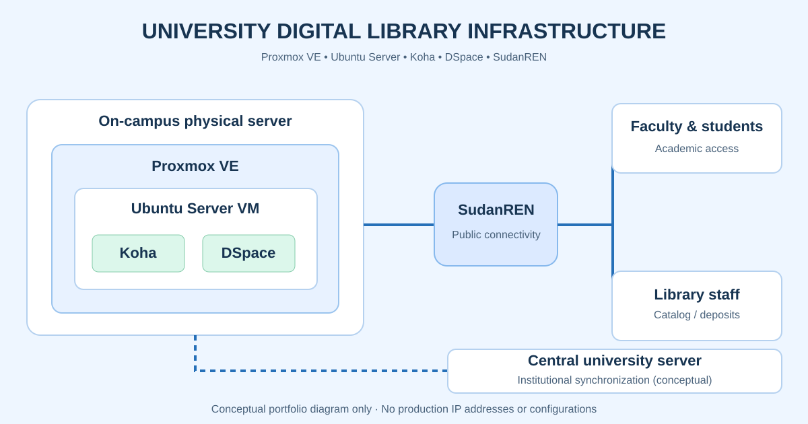

# Bibliothèques numériques et infrastructure universitaire

**Proxmox VE · Ubuntu Server · SudanREN · Koha · DSpace**

## Présentation

Déploiement d'un serveur physique dans une université soudanaise, installation de **Proxmox VE** et d'une machine virtuelle **Ubuntu Server** pour héberger les systèmes **Koha** et **DSpace** destinés aux bibliothèques et aux publications scientifiques.

## Réalisations

- Installation et configuration du serveur et de l'environnement de virtualisation.
- Connexion des services universitaires avec une adresse publique fournie via **SudanREN**.
- Mise en place de Koha pour la gestion documentaire et de DSpace pour les collections numériques.
- Accès aux ressources pour les étudiants et les enseignants.
- Création de comptes et permissions pour les bibliothécaires, afin de saisir les ouvrages et publications.
- Synchronisation avec un serveur central universitaire dans l'environnement du ministère soudanais de l'Enseignement supérieur et de la Recherche scientifique, selon le responsable du projet.

## Responsabilités

Installation matérielle, configuration Proxmox et Ubuntu, réseau universitaire, applications documentaires, accès et intégration institutionnelle.

Le schéma représente une **architecture conceptuelle**, et non un plan réel de production. Les adresses et paramètres sensibles ne sont pas publiés.

[Étude de cas sur FatihMH](https://fatihmh.online/fr/bibliotheques-numeriques-koha-dspace-universite/)

© 2026 Elfatih Mohamed Hameid Farah — Tous droits réservés.
